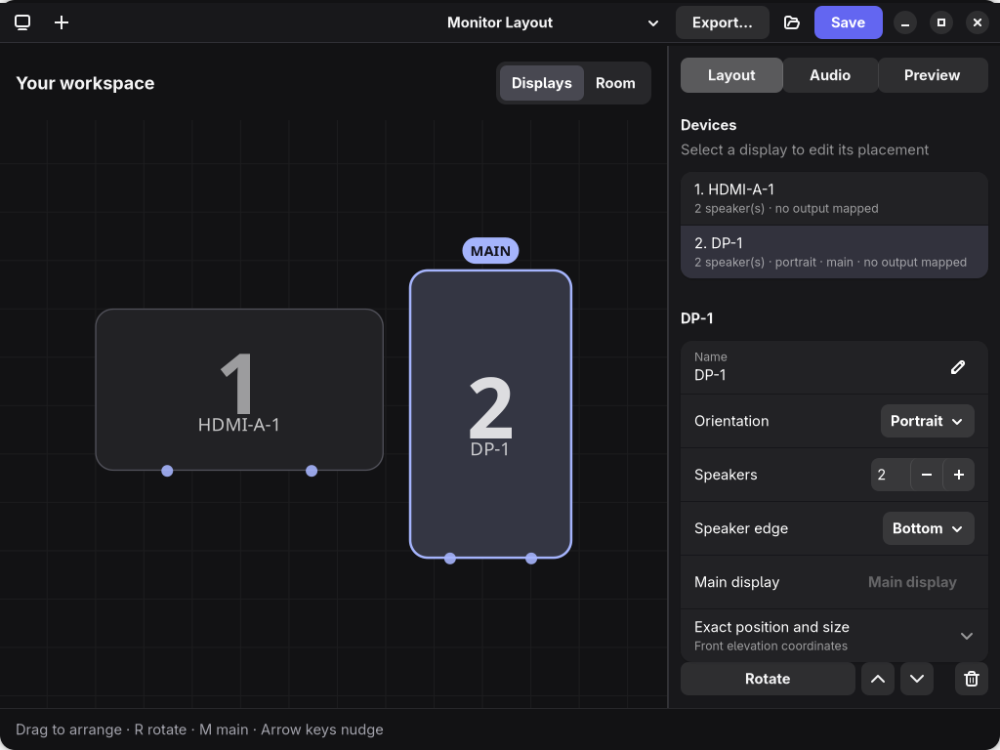
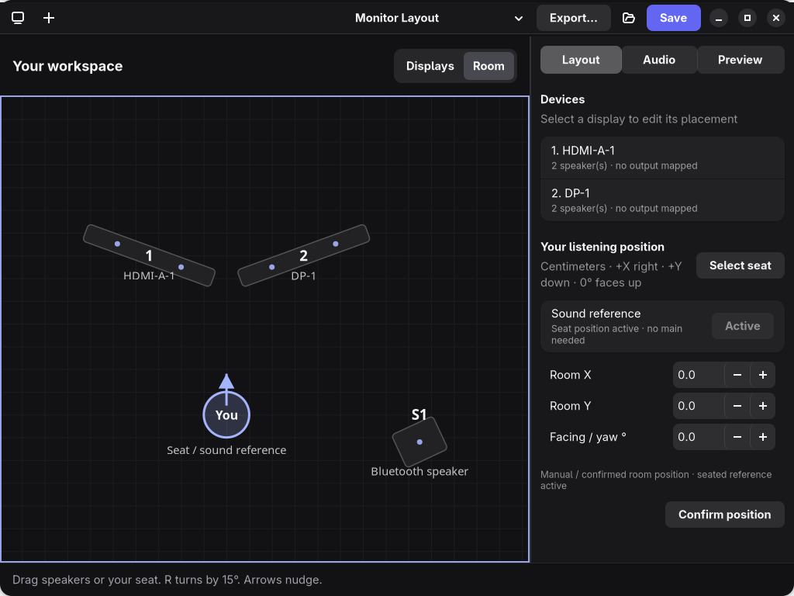

# PipeWire Audio Output Controller & Dual Monitor Setup

This repository contains the configurations, scripts, and a graphical user interface (GUI) designed to customize and manage your Linux audio output under **PipeWire** and **WirePlumber**. 

Specifically, it sets up:
1. A **custom 4-channel panning layout** that routes your stereo audio across a dual-monitor speaker setup.
2. A **GTK 4 / Libadwaita GUI application** to view outputs, control volumes, mute devices, and switch active playback targets.
3. A **dynamic bash script** to instantly toggle your system's default output between your USB DAC (IEMs) and your custom speaker setup (e.g., for binding to a keyboard hotkey).

---

## Repository Contents

*   **`dual-monitor.conf`**: PipeWire module configuration file that sets up virtual filter-chains and a combined audio sink.
*   **`audio-output-controller.py`**: A python-based GTK 4 & Libadwaita desktop GUI application.
*   **`toggle-audio.sh`**: A lightweight shell script that parses PipeWire IDs dynamically to toggle audio outputs.
*   **`audio-output-controller.desktop`**: The system desktop entry file to integrate the GUI app into your application menus and launchers (Rofi, Walker, etc.).

---

## 1. Dual Monitor Speaker Layout Setup

The `dual-monitor.conf` configuration maps standard stereo audio into a combined sink (`dual_monitor_sink`) which splits audio to your left and right monitors using a custom panning blend:
*   **Left Speaker (Left Monitor)**: Left channel only.
*   **Right Speaker (Left Monitor)**: Mono blend (Left + Right).
*   **Left Speaker (Right Monitor)**: Mono blend (Left + Right).
*   **Right Speaker (Right Monitor)**: Right channel only.

### Installation:
1. Create the configuration directory if it doesn't exist:
    ```bash
    mkdir -p ~/.config/pipewire/pipewire.conf.d/
    ```
2. Copy `dual-monitor.conf` into that directory:
    ```bash
    cp dual-monitor.conf ~/.config/pipewire/pipewire.conf.d/
    ```
3. Review the device names and routing before activation. Follow your distribution’s instructions to reload the relevant user audio services or log out and back in when convenient. This interrupts audio; service names and activation methods vary, and `pipewire-pulse` may not be installed. Keep a backup so you can remove or restore the fragment if activation fails.

---

## 2. Desktop GUI Controller Application

The GUI provides a card-based view of all your hardware and virtual outputs (such as your USB DAC / IEMs and the custom `dual_monitor_sink`), showing active defaults, real-time volume sliders, and mute toggles.

### Dependencies:
Make sure python, GTK 4, Libadwaita, and PyGObject bindings are installed on your Linux system.
*   **Arch Linux / CachyOS**:
    ```bash
    sudo pacman -S python-gobject libadwaita
    ```
*   **Debian / Ubuntu**:
    ```bash
    sudo apt install python3-gi gir1.2-gtk-4.0 gir1.2-adw-1
    ```

### Installation:
1. Copy the script to your local bin path and make it executable:
    ```bash
    mkdir -p ~/.local/bin/
    cp audio-output-controller.py ~/.local/bin/audio-output-controller
    chmod +x ~/.local/bin/audio-output-controller
    ```
2. Copy the desktop entry shortcut to make it searchable in system launchers:
    ```bash
    mkdir -p ~/.local/share/applications/
    cp audio-output-controller.desktop ~/.local/share/applications/
    ```
3. Update the desktop entries database to register the app:
    ```bash
    update-desktop-database ~/.local/share/applications
    ```

---

## 3. Keyboard Shortcut Audio Toggle Script

The `toggle-audio.sh` script dynamically queries WirePlumber to find the current active output device and toggles default audio routing between your IEMs (USB DAC) and Speakers (`dual_monitor_sink`). Because it matches devices by name rather than arbitrary ID integers, it is robust and won't break if you plug/unplug your DAC.

### Setup:
1. Copy `toggle-audio.sh` into your bin folder and make it executable:
    ```bash
    cp toggle-audio.sh ~/.local/bin/toggle-audio
    chmod +x ~/.local/bin/toggle-audio
    ```
2. Run it at any time in terminal to switch outputs:
    ```bash
    toggle-audio
    ```
3. **Set a Hotkey:** You can bind this script to a media key or keyboard shortcut in your window manager.
    *   **Hyprland** (`hyprland.conf` example):
        ```ini
        # Toggle audio output between IEMs and speakers on a hotkey
        bind = $mainMod, Backspace, exec, ~/.local/bin/toggle-audio
        ```
    *   **i3 / Sway** (`config` example):
        ```text
        bindsym $mod+BackSpace exec ~/.local/bin/toggle-audio
        ```

---

## 4. Monitor Layout GUI

`monitor-layout-gui.py` is a native GTK4/Libadwaita editor for monitor and standalone-speaker layouts. It does not run or modify the legacy controller, toggle script or fixed `dual-monitor.conf` configuration.

### Screenshots

Captured from the current native GTK interface using demo fixtures only. No live audio devices or personal desktop content are shown.

**Display arrangement:** numbered monitors, portrait/landscape orientation and an optional main display.



**Listening area:** two angled displays, a movable seated reference and a standalone speaker. No main display is required. The Bluetooth speaker is illustrative fixture data, not a live connection or acoustic test.



### Run from source

From the repository root:

```bash
python3 monitor-layout-gui.py --demo
python3 monitor-layout-gui.py
python3 monitor-layout-gui.py --file /path/to/layout.json
```

Demo mode uses fixtures, including repeated discovery actions, without querying the compositor or live audio graph. Normal mode discovers PipeWire outputs read-only with `pw-dump`; display detection supports Hyprland (`hyprctl monitors -j`) and generic Wayland (`wlr-randr`). Unsupported desktops can use manual placement.

Dependencies: Python 3.11+ (tested with 3.14), GTK4 >= 4.10, Libadwaita, PyGObject, Cairo and Pango bindings. Use your distribution's packages. On Arch/CachyOS these include `python-gobject`, `python-cairo`, `gtk4` and `libadwaita`; on Debian/Ubuntu, `python3-gi`, `python3-gi-cairo`, `gir1.2-gtk-4.0` and `gir1.2-adw-1`. Discovery commands are optional.

### Install the GUI only

```bash
sh scripts/install-user.sh
```

This explicitly installs a self-contained user-local copy of the GUI, its package and fixtures, plus its launcher and desktop entry. It does not install dependencies, audio routing fragments, or the legacy controller; it does not restart services or change the default sink. The installed copy does not depend on retaining this checkout. Review `scripts/install_user.py` for destinations and overwrite behavior.

### Arrange displays and your listening area

1. Detect or manually add displays. In **Displays**, click to select, drag to reposition, use arrows to nudge, and press R to swap portrait/landscape. M marks a display as main, but a main display is optional in new layouts.
2. Switch to **Room**. Drag the seat and numbered displays into their room positions. R turns the selected object or your facing direction by 15°. Inspector fields allow precise coordinates, yaw and speaker span. Coordinates are centimeters, +X right and +Y down; facing 0° looks toward negative Y.
3. New layouts use the seat and facing direction as the sound reference. Marking a main display does not move that reference. For an older profile using the legacy main-display reference, choose **Use seat** to switch.
4. Initial room geometry is an explicitly approximate projection, not a measurement. Unconfirmed display positions follow horizontal front-view arrangement, while front-view height never becomes room depth. The seat initially stays centered. Moving or confirming a room object protects its room placement from later front-view edits; manually moving the seat protects its placement too.

The same monitor numbers identify displays in both views. Standalone speakers have S-number labels. Portrait/landscape describes the screen, while room yaw describes its angle around the seat. Neither operation automatically calibrates speaker wiring.

### Map monitor and standalone speakers

1. Detect outputs or use demo fixtures. Map each display to its actual output, or use **Add speaker** for a standalone wired, USB or Bluetooth speaker.
2. Known headphones and virtual sinks are excluded. Unknown outputs require explicit confirmation that they are speakers, not headphones. Bluetooth transport alone is not evidence of a speaker.
3. Set and confirm the number of physical drivers yourself. Reported audio channels do not prove a physical driver count. A newly added standalone speaker starts with one unconfirmed driver rather than guessing from stereo channels.
4. Use **Set order…** to assign a discovered channel label to every physical slot in the order shown. Labels such as FL, FR and FC are retained, but discovery order is not assumed to be physical wiring order. Missing, duplicate or unknown labels block confirmation/export; the editor never invents AUX labels.
5. Place speakers in the listening area and inspect the gain preview. Disconnected mappings remain visible and removable; export blocks disconnected targets instead of routing to another output.

Stable slot identities survive placement, yaw, screen orientation and list reordering. Changing driver count or mapped output clears channel-order confirmation. Speaker edge is explicitly selected in front-view coordinates; screen rotation does not silently relocate the edge or verify channel wiring.

### Save profiles and migrate older layouts

Use Save to choose a JSON profile; the suggested profile directory is `~/.config/monitor-layout/profiles` (or the corresponding `XDG_CONFIG_HOME` directory). Saving/loading profiles never changes PipeWire.

Schema 3 stores the seated reference, independent room geometry, peripherals, physical counts, channel order and explicit speaker-type confirmation. Schema 1 and 2 profiles load with their original front geometry and legacy main reference, plus approximate initial room positions. Schema 2 retains its explicit channel order; schema 1 requires fresh channel-order confirmation. Older profiles do not imply speaker-type confirmation for unknown outputs. Saving writes schema 3; keep an original copy if an older editor must still read it.

### Export, install and roll back audio routing

Export writes a reviewable PipeWire `filter-chain` + `combine-stream` fragment after static checks. It does not activate it. Review the named targets, physical channel assignments and gain preview before installing.

```bash
python3 -m monitor_layout.apply install /path/to/exported.conf
python3 -m monitor_layout.apply rollback --conf-dir ~/.config/pipewire/pipewire.conf.d
```

The explicit routing installer writes `monitor-layout.conf` in the user PipeWire configuration directory, keeping a timestamped backup when replacing a previous fragment. Rollback restores the newest backup. These commands are separate from the GUI-only installer above.

Neither the GUI nor these commands restart PipeWire or change the default output. Activation is a manual, distribution-dependent step that can interrupt audio. Check which user audio services your system actually runs, follow its reload/restart instructions, or log out and back in when appropriate. Do not assume a `pipewire-pulse` service exists. After successful activation, choose **Monitor Layout Combined Sink** yourself. Restore/remove the fragment and follow the same distribution guidance if activation fails.

### Gain behavior and honest limitations

- Stereo uses amplitude-based left/right spread across all placed speakers, including those behind the seat. This is stereo widening, not discrete rear or object surround.
- 5.1 uses room speaker azimuth relative to the seated facing direction. Unsupported directions are explicitly folded rather than silently discarded. Export refuses an input channel with no mapped audible destination.
- Per-input and per-output amplitude sums stay within headroom after rounding. Mixing multiple channels may attenuate them; it does not increase gain.
- Explicit target binding, no fallback and no remix prevent disconnected speakers from redirecting audio to an unintended output.
- Combine-stream latency compensation matches reported stream latencies with delay buffers. Bluetooth variable delay and independent clocks can still cause audible delay or drift. This is not calibrated acoustic synchronization. After reconnection, rediscover and regenerate/reinstall explicitly as needed.
- Display detection is not a room measurement. Mixed-DPI detection uses a shared approximate scale; check physical dimensions and room placement yourself. Stacked displays never become rear speakers merely because of their front-view Y coordinate.
- No live audio calibration, test tones or Bluetooth connection management are performed. Correct physical wiring and sound quality still require user verification.
- An isolated PipeWire load test can prove that a fragment parses and creates nodes, but not that hardware links, channel wiring or real-world sound work. A private runtime without hardware/session-manager routing can legitimately have zero links.
- The legacy volume controller does operate on live sinks. It is a separate application with different behavior.
- The native GUI itself has no network listener, credentials or background service.

### Tests and optional visual QA

Run from the repository root with pytest installed:

```bash
python3 -m pytest -q
python3 scripts/run_gui_tests.py
# Equivalent explicit GUI selection:
python3 scripts/run_gui_tests.py tests/test_gui.py tests/test_room_canvas_gui.py -q
```

The first command runs the display-free core tests and skips the two GUI modules. The GUI runner requires `gtk4-broadwayd` and `dbus-run-session`; it runs both GUI modules in private temporary XDG directories and a private Broadway display/D-Bus session, not on the desktop. It cleans up only its own child processes.

For optional browser-based visual QA:

```bash
dbus-run-session -- python3 scripts/preview_demo.py
```

This QA-only helper starts a fixture-only GUI with a temporary Broadway service bound to `127.0.0.1` (default port 8731). Open the printed localhost URL and stop it with Ctrl-C; it also has a one-hour limit. The helper is not needed to launch or install the application, and its localhost service is not part of normal GUI operation.

### Workspace navigation

The native editor opens in dark mode. Use **Displays / Room** above the canvas to switch between front elevation and independent top-down placement. The right inspector separates **Layout**, **Audio**, and **Preview**. Select a device to edit it; audio mappings expand to show confirmation and channel-order controls. **Sound reference → Use seat** removes the main-display requirement; the row shows when the seat is already active. **Preview → Source format** chooses Stereo or 5.1 as the fixed exported sink input format, not automatic live-source detection. Saving and exporting remain explicit and never apply live routing.

Reproduce the fixture-only native screenshots with `python3 scripts/capture_gui.py`. This uses a private Broadway display, not the desktop or real audio hardware.
